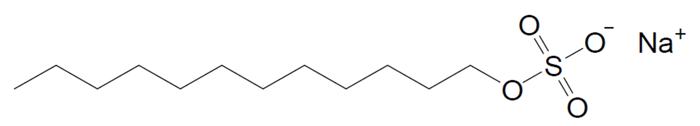
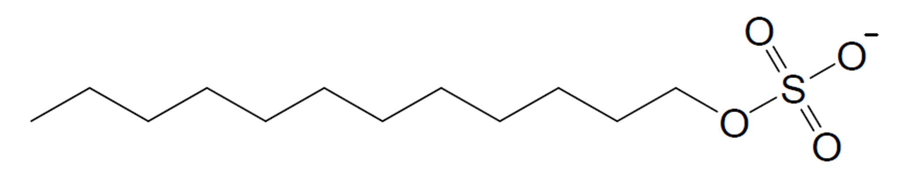
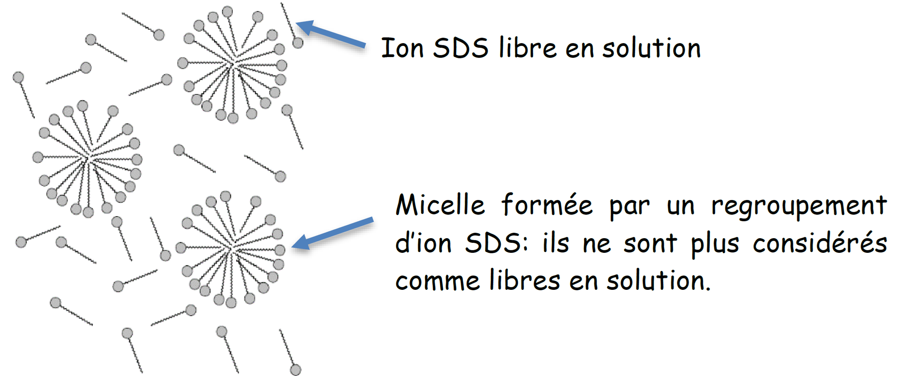

# S09 – 🧪 TP 1 – Mesure de la CMC par conductimétrie

## 🎯 Objectifs du TP

### Objectifs scientifiques et cosmétologiques

- mettre en évidence le **comportement d’un tensioactif en solution aqueuse**,
- comprendre le lien entre **conductivité** et **concentration en ions libres**,
- déterminer expérimentalement la **concentration micellaire critique (CMC)**,
- relier un résultat expérimental à une **organisation moléculaire**.

### Objectifs méthodologiques (préparation E2)

- exploiter un **résultat expérimental**,
- analyser un **graphique scientifique**,
- identifier une **rupture de comportement**,
- rédiger une **conclusion scientifique argumentée**.

---

## 🧴 Contexte professionnel

Les tensioactifs sont des composants essentiels des **produits cosmétiques lavants** (shampooings, gels douche, savons liquides).

Le **dodécylsulfate de sodium (SDS)** est un tensioactif ionique couramment utilisé.
En formulation cosmétique, il est essentiel de connaître la **concentration minimale efficace** à partir de laquelle les micelles se forment : la **CMC**.

---

## 📎 Documents fournis

### Document 1 – Le dodécylsulfate de sodium (SDS)

Le **dodécylsulfate de sodium** ou **Laurylsulfate de sodium** (noté en abrégé SDS dans la littérature anglo-saxonne où son nom  est  Sodium  Dodecyl  Sulphate)  est  un  tensioactif  ionique  que  l’on  trouve  dans  les shampooings.

L’anion dodécylsulfate présente la particularité de posséder une tête hydrophile et une chaîne carbonée hydrophobe.

> 💡 Tu ne te souviens plus comment lire cette formule ? Voir le **Document 5 – partie 1**.

---

### Document 2 – La CMC : Concentration Micellaire Critique

En solution aqueuse, les ions dodécylsulfate peuvent s’organiser en donnant des agrégats
microscopiques nommés **micelles**.  
On envisage ici la formation de **micelles sphériques** : le cœur de la micelle est constitué des parties **hydrophobes** de l’ion dodécylsulfate ; les **têtes polaires** de cet ion, ainsi que des **contre-ions Na⁺**, se trouvent à la surface.

Les micelles ne se forment que si la concentration en tensioactif introduit $C(\text{SDS})_{\text{introduit}}$ est **supérieure à une valeur limite** appelée **concentration micellaire critique (CMC)**.

On distingue deux situations :

- **Situation 1 :**  
    La concentration en tensioactif introduit  $C(\text{SDS})_{\text{introduit}}$ est **inférieure à la CMC**.  
    Les ions $\mathrm{C_{12}H_{25}OSO_3^-}$ sont **libres en solution** et leur concentration  $C(\text{SDS})_{\text{libre}}$  est **égale à la concentration introduite**.

- **Situation 2 :**  
  La concentration en tensioactif introduit  $C(\text{SDS})_{\text{introduit}}$  est **supérieure à la CMC**.  
  Des **micelles se forment**.  
  La concentration  $C(\text{SDS})_{\text{libre}}$  des ions $\mathrm{C_{12}H_{25}OSO_3^-}$ libres est alors **égale à la CMC**, même si la concentration introduite continue d’augmenter.

---

### Document 3 – Tout est question de concentration

Quand on ajoute du SDS à une solution aqueuse, celui-ci se dépose à la surface avec ses **têtes hydrophiles** en contact avec l’eau et les **queues hydrophobes apolaires** orientées vers l’air, afin de **minimiser les interactions défavorables** entre ces dernières et la phase aqueuse polaire.

Une fois que **toute la surface est recouverte de SDS** (la **CMC est alors atteinte**), les molécules de tensioactif ne peuvent plus s’y fixer.
La seule façon d’empêcher les **queues apolaires** d’entrer en contact avec la phase aqueuse est alors que ces dernières **s’agglutinent pour former des micelles**.

Les micelles peuvent alors **piéger les salissures grasses**, qui se concentrent au centre hydrophobe de la micelle.
C’est le **principe d’action des lessives, détergents, savons et shampooings**.

---

### Document 4 – Rappel : principe de la dilution

La dilution consiste à obtenir une solution **moins concentrée** à partir d’une solution initiale plus concentrée, appelée **solution mère**.

Lors d’une dilution :

- la **quantité de soluté** reste la même,
- seul le **volume de solution** augmente.

La relation de dilution s’écrit :

$$C_{\text{mère}} \times V = C_{\text{fille}} \times V'$$

où :

- $C_{\text{mère}}$ est la concentration de la solution mère,
- $V$ est le volume de solution mère prélevé,
- $C_{\text{fille}}$ est la concentration de la solution obtenue,
- $V'$ est le volume final de la solution diluée.

On définit le **facteur de dilution** $F$ par :

$$F = \dfrac{V'}{V}$$

Plus le facteur de dilution est élevé, plus la solution obtenue est diluée.

⚠️ Lors d’une dilution :

- le prélèvement se fait à l’aide d’une **pipette**,
- le volume final est ajusté dans une **fiole jaugée**.

---

### Document 5 – Lire une formule topologique et comprendre « hydrophile / hydrophobe »

#### 1) Rappel : lire une formule topologique

En chimie, on dessine souvent les molécules de façon simplifiée : c'est la **formule topologique**. Voici les règles pour la lire :

* la chaîne de carbones est dessinée en **zigzag** ;
* chaque **extrémité** et chaque **angle** (sommet) du zigzag représente **un atome de carbone C** ;
* les **atomes d'hydrogène H liés aux carbones ne sont pas dessinés** : un carbone fait toujours **4 liaisons**, on complète donc avec autant de H qu'il en manque ;
* les **autres atomes** (O, S, N, Na…) sont **écrits avec leur symbole**, ainsi que les H qui leur sont liés (par exemple –OH) ;
* un trait = une liaison simple ; deux traits = une double liaison.

**Exemple 1 : le butane**

<svg width="230" height="95" viewBox="0 0 230 95" xmlns="http://www.w3.org/2000/svg" font-family="sans-serif" font-size="13">
<polyline points="25,70 80,30 135,70 190,30" fill="none" stroke="currentColor" stroke-width="2.5"/>
<g fill="#d81b60"><circle cx="25" cy="70" r="5"/><circle cx="80" cy="30" r="5"/><circle cx="135" cy="70" r="5"/><circle cx="190" cy="30" r="5"/></g>
<g fill="#d81b60"><text x="18" y="90">C1</text><text x="73" y="18">C2</text><text x="128" y="90">C3</text><text x="183" y="18">C4</text></g>
</svg>

On compte **4 sommets → 4 atomes de carbone**.

* C1 et C4 (aux extrémités) ne sont liés qu'à **1** carbone → il leur faut **3 H** : ce sont des $\mathrm{CH_3}$ ;
* C2 et C3 (au milieu) sont liés à **2** carbones → il leur faut **2 H** : ce sont des $\mathrm{CH_2}$.

Bilan : $2 \times 3 + 2 \times 2 = 10$ H → formule brute $\mathrm{C_4H_{10}}$.

**Exemple 2 : l'éthanol** (l'alcool des parfums)

<svg width="200" height="95" viewBox="0 0 200 95" xmlns="http://www.w3.org/2000/svg" font-family="sans-serif" font-size="16">
<polyline points="25,70 80,30 128,62" fill="none" stroke="currentColor" stroke-width="2.5"/>
<text x="132" y="76" fill="currentColor" font-weight="bold">OH</text>
</svg>

On compte **2 carbones** (les deux sommets) ; l'oxygène est **écrit** avec son hydrogène → formule brute $\mathrm{C_2H_6O}$.

> 💡 **Méthode pour la chaîne du SDS** : compte les sommets du zigzag → **12 carbones**.
> Le carbone de l'extrémité est un $\mathrm{CH_3}$, les 11 autres sont des $\mathrm{CH_2}$ :
> $3 + 11 \times 2 = 25$ H → on retrouve bien la chaîne $\mathrm{C_{12}H_{25}}$.

#### 2) Pourquoi parle-t-on de liaison « polaire » ?

Une **liaison** entre deux atomes, ce sont des **électrons partagés** entre ces deux atomes (les électrons portent une charge **négative**).

On peut imaginer un **tir à la corde** : chaque atome « tire » sur les électrons de la liaison. Certains atomes tirent **plus fort** que d'autres. Cette force s'appelle l'**électronégativité**.

| Atome | H | C | S | O |
|---|---|---|---|---|
| Électronégativité | 2,2 | 2,6 | 2,6 | 3,4 |

👉 **L'oxygène O est le plus « gourmand » en électrons.**

* Si les deux atomes tirent **à peu près autant** (écart faible) : les électrons restent au milieu → liaison **non polaire**.
* Si un atome tire **beaucoup plus fort** : les électrons se rapprochent de lui → il devient **un peu négatif**, noté $\delta^-$ ; l'autre devient **un peu positif**, noté $\delta^+$ → liaison **polaire**.

Le symbole $\delta$ (« delta ») veut dire « **un petit peu** » : ce n'est pas une vraie charge comme celle de l'ion $\mathrm{Na^+}$, c'est une **charge partielle**.

| Liaison | Écart d'électronégativité | Type |
|---|---|---|
| C–C | 0 | **non polaire** |
| C–H | 0,4 (faible) | **(quasi) non polaire** |
| S–O | 0,8 | **polaire** |
| O–H | 1,2 | **très polaire** |

#### 3) L'eau : une molécule polaire

Dans la molécule d'eau $\mathrm{H_2O}$, l'oxygène attire fortement les électrons des deux liaisons O–H :

* l'**oxygène** porte une charge partielle **négative** $\delta^-$ ;
* les **hydrogènes** portent une charge partielle **positive** $\delta^+$.

<svg width="220" height="120" viewBox="0 0 220 120" xmlns="http://www.w3.org/2000/svg" font-family="sans-serif" font-size="18">
<line x1="110" y1="45" x2="60" y2="90" stroke="currentColor" stroke-width="2.5"/>
<line x1="110" y1="45" x2="160" y2="90" stroke="currentColor" stroke-width="2.5"/>
<circle cx="110" cy="40" r="17" fill="#e53935"/><text x="104" y="46" fill="white" font-weight="bold">O</text>
<circle cx="55" cy="95" r="12" fill="#90a4ae"/><text x="49" y="101" fill="white" font-weight="bold">H</text>
<circle cx="165" cy="95" r="12" fill="#90a4ae"/><text x="159" y="101" fill="white" font-weight="bold">H</text>
<text x="132" y="25" fill="#e53935">δ−</text>
<text x="18" y="100" fill="#1e88e5">δ+</text><text x="182" y="100" fill="#1e88e5">δ+</text>
</svg>

La molécule est **coudée** (en forme de V) : il y a donc un côté $\delta^-$ et un côté $\delta^+$. Les molécules d'eau **s'attirent entre elles** ($\delta^+$ de l'une vers le $\delta^-$ de l'autre).

On peut retenir :

* l'eau **attire tout ce qui est chargé ou polaire** (zones avec $\delta^+$ / $\delta^-$ ou vraies charges) → ces zones sont **hydrophiles** (*hydro* = eau, *phile* = qui aime) ;
* l'eau **n'a aucune prise** sur les zones non polaires : les molécules d'eau préfèrent rester entre elles et **repoussent** ces zones → elles sont **hydrophobes** (*phobe* = qui craint).

C'est pour cela que l'**huile** (non polaire) ne se mélange pas à l'**eau** : on dit souvent « **qui se ressemble s'assemble** ».

#### 4) Application au SDS

* **Tête hydrophile (sulfate)** : elle contient plusieurs atomes **O** (liaisons S–O et C–O **polaires**) et porte une **charge négative** globale ($\ldots\mathrm{SO_3^-}$)
  
  → donc **fortes interactions avec l'eau** (attraction eau ↔ charge / $\delta$)
  → **hydrophile**

* **Queue hydrophobe (chaîne carbonée $\mathrm{C_{12}H_{25}}$)** : elle ne contient que des liaisons **C–C** et **C–H**
  
  → zone **non polaire**, sans charge marquée
  → l'eau interagit très peu avec cette zone
  → **hydrophobe**

**Phrase à retenir** :

> **Chargé / très polaire → hydrophile ; non polaire (C–C, C–H) → hydrophobe.**

---

## 🧠 PARTIE A – Exploitation documentaire préalable

### 1. Structure du tensioactif SDS

1\. Identifier les **deux parties** de l’ion dodécylsulfate.  
    

2\. Préciser le **comportement de chacune** vis-à-vis de l’eau.  
    

3\. **Expliquer pourquoi** la tête est **hydrophile** et la queue **hydrophobe** (à l’aide du **Document 5**).
Pour t’aider, réponds aux 3 sous-questions :

3a. Repérer sur la **tête** les éléments qui rendent la zone “aimée par l’eau” :

* présence de quel(s) atome(s) ?
* présence d’une charge globale ?     

3b. Repérer sur la **queue** le type de liaisons majoritaires (C–C ? C–H ? autres ?) et dire si cette zone est plutôt **polaire** ou **non polaire**.     

3c. Conclure en une phrase :
“Donc la tête est … car … ; la queue est … car …”      

---

### 2. Organisation en solution aqueuse

4\. Décrire l’organisation des molécules de SDS :

- lorsque la concentration est **inférieure à la CMC**,
- lorsque la concentration est **supérieure à la CMC**.  
     

5\. Expliquer ce qu’est une **micelle** et préciser son **rôle en cosmétologie**.  
     

---

### 3. Définition de la CMC

6\. Proposer une **définition précise** de la CMC.  
    

7\. Expliquer pourquoi la CMC correspond à une **concentration seuil**.  
     

---

## 🧪 PARTIE B – Manipulation expérimentale

### 4. Protocole expérimental

Une solution **mère** de SDS de concentration massique  $C_{\text{mère}} = 11{,}5~\text{g·L}^{-1}$ a été préparée à l’avance afin d’éviter la formation de mousse.

On prélève différents volumes $V$ de cette solution mère, que l’on dilue avec de l’eau distillée pour obtenir un **volume final de 50 mL**.

---

### 5. Principe de la dilution

8\. Rappeler le principe de la dilution reliant  $C_{\text{mère}}$, $V$, $C_{\text{fille}}$, $V'$.  
     

9\. Définir le **facteur de dilution $F$**.  
     

---

### 6. Préparation des solutions

10\. Remplir le tableau suivant :

on a :

- La solution mère de SDS a une concentration massique : $C_{\text{mère}} = 11{,}5~\text{g·L}^{-1}$.
- Les solutions filles de SDS ont un volume de 50 mL 

| Solution | S1 | S2 | S3 | S4 | S5 | S6 | S7 | S8 | S9 |
|--------|----|----|----|----|----|----|----|----|----|
| Volume prélevé (mL) | 1,0 | 3,0 | 5,0 | 9,5 | 10,5 | 12,5 | 14,5 | 16,0 | 17,5 |
| Facteur de dilution | | | | | | | | | |
| Concentration (g·L⁻¹) | | | | | | | | | |

11\. Décrire le **protocole de préparation** et la verrerie utilisée, parmi

-	Burette graduée, pipettes jaugées de 5, 10 et 20mL.
-	Petits béchers de prélèvement ou transvasement.
-	Béchers de 50mL.
-	Fiole jaugée de 50mL.

     

> ⚠️ **Consigne importante** : mesurer les solutions dans l'ordre **S1 → S9** (de la moins concentrée à la plus concentrée). Rincer la sonde du conductimètre à l'eau distillée entre chaque mesure.

---

### 7. Conductivité et concentration

La conductivité $\sigma$ d’une solution ionique est proportionnelle à la **concentration en ions libres** : $\sigma = k \times C$

12\. Quelle est l’allure attendue de la courbe   $\sigma = f(C)$ ?  
     

---

### 8. Mesure de la conductivité

| Solution | S1 | S2 | S3 | S4 | S5 | S6 | S7 | S8 | S9 |
|--------|----|----|----|----|----|----|----|----|----|
| Concentration (g·L⁻¹) | | | | | | | | | |
| Conductivité (mS·cm⁻¹) | | | | | | | | | |

---

## 🧠 PARTIE C – Exploitation des résultats

13\. Tracer le graphique $\sigma = f(C)$.  

14\. Mettre en évidence **deux zones de comportement**.  
     

15\. Déterminer graphiquement la **CMC du SDS** (en g·L⁻¹).  
     

---

## ✍️ PARTIE D – Interprétation cosmétologique (E2)

16\. Le fait d’augmenter fortement la concentration en SDS
au-delà de la CMC est-il pertinent ?  Rédiger une **réponse argumentée (6 à 8 lignes)**.  
      

---

## 🧾 Conclusion

Valeur de la CMC – sens physico-chimique – intérêt en formulation cosmétique.  
       

---

## 🔗 Lien explicite avec la méthode

Pour analyser correctement ces documents, se référer à :

➡️ [**Fiche méthode 03 – Interpréter un graphique / tableau (ex : CMC)**](https://bts-mecp-cosmetologie-f42365.forge.apps.education.fr/Methodologie/03_fiche_methode/)